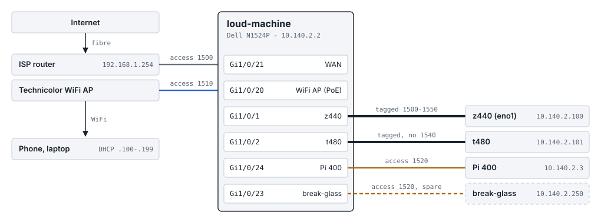
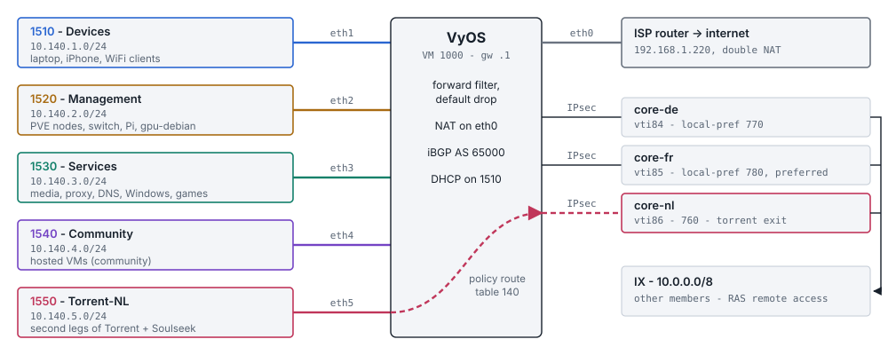
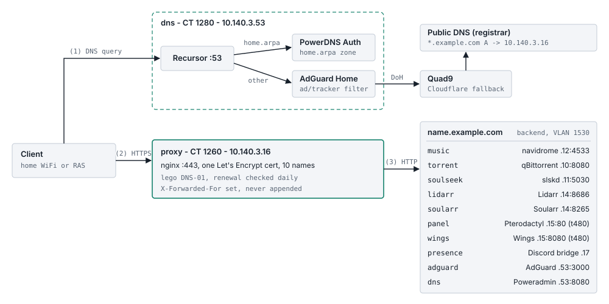
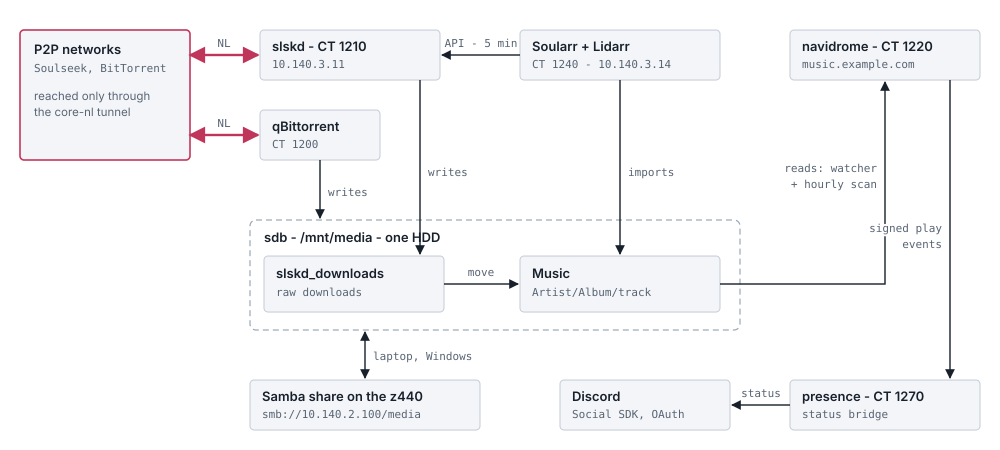
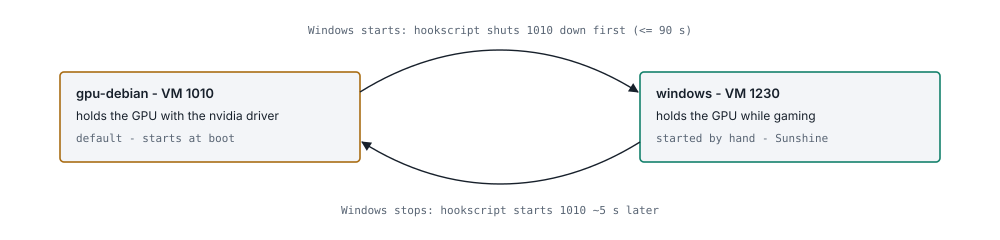
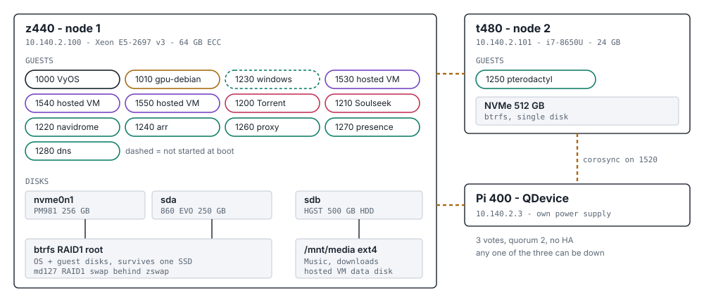

# homelab

# Brief

This repo is the real, working configuration of my homelab: two Proxmox nodes, a VyOS router VM, a managed switch and the services that run on top of them. I decided to publish it for two reasons. One is to keep track of how everything is set up in one place. Second is for people to be able to look at a complete, working example instead of piecing one together from forum posts.

Note: secrets, keys and the domain are replaced with placeholders (see [Placeholders](#placeholders)). Everything else (VLANs, private addresses, firewall rules) is as it runs.

## Features

Main features of this setup are:

- Every zone is its own VLAN, and one VyOS VM routes and firewalls between all of them (default drop).
- Two node Proxmox cluster with a Raspberry Pi 400 as the third vote (QDevice).
- BGP over three IPsec tunnels into a private community exchange network (IX).
- Torrent and Soulseek traffic leaves only through one tunnel, and stops if that tunnel is down (fail-closed).
- HTTPS for every internal web app through one nginx reverse proxy and a Let's Encrypt cert (DNS-01).
- Own DNS: PowerDNS for the local `home.arpa` zone and AdGuard Home for ad blocking.
- GPU passthrough with an automatic handoff between a Linux VM and a Windows gaming VM.
- Music pipeline: Soulseek -> Lidarr -> Navidrome, with the current song shown as a Discord status.

## Overview

```
Fibre -> ISP router (192.168.1.254)
           `- Gi1/0/21 -> Dell N1524P "loud-machine" (10.140.2.2)
                            |- Gi1/0/1  trunk -> z440  (Proxmox node 1)
                            |                     `- OVS bridge "ovs" -> VyOS VM 1000 (routes every zone)
                            |- Gi1/0/2  trunk -> t480  (Proxmox node 2)
                            |- Gi1/0/20 1510  -> WiFi AP
                            |- Gi1/0/24 1520  -> Pi 400 (cluster tie-breaker)
                            `- Gi1/0/23 1520  -> break-glass port (spare)
```

| VLAN | Subnet | Purpose |
|---|---|---|
| 999 | n/a | Blackhole, native VLAN on the trunks (untagged frames are dropped) |
| 1500 | 192.168.1.0/24 | WAN only, towards the ISP router (double NAT) |
| 1510 | 10.140.1.0/24 | Personal devices, the only VLAN with DHCP |
| 1520 | 10.140.2.0/24 | Management: Proxmox nodes, switch, Pi, gpu-debian |
| 1530 | 10.140.3.0/24 | Services (VMs and containers) |
| 1540 | 10.140.4.0/24 | Hosted VMs for the community network |
| 1550 | 10.140.5.0/24 | Torrent egress legs, policy-routed into the NL tunnel |

## Diagrams

| | |
|---|---|
| Cabling |  |
| Routing + firewall |  |
| Web access (HTTPS) |  |
| Music pipeline |  |
| GPU custody |  |
| Hosts, guests, disks |  |

## Repository layout

```
homelab/
|-- docs/                     diagrams (SVG)
|-- network/
|   |-- vyos/                 full VyOS config as `set` commands + boot script
|   `-- switch/               Dell N1524P running-config
|-- proxmox/
|   |-- host/                 OVS interfaces, GPU hookscript, Samba, sysctl, modprobe, GRUB cmdline
|   |-- guests/               qemu-*.conf / lxc-*.conf for every VM and container
|   |-- storage.cfg
|   `-- corosync.conf
`-- services/
    |-- torrent/              qBittorrent + route unit (CT 1200)
    |-- soulseek/             slskd + route unit (CT 1210)
    |-- navidrome/            Navidrome (CT 1220)
    |-- arr/                  Lidarr + Soularr docker-compose (CT 1240)
    |-- pterodactyl/          Panel compose, Wings config, in-container firewall (CT 1250)
    |-- proxy/                nginx sites + lego renewal (CT 1260)
    |-- presence/             Discord status bridge settings + nftables (CT 1270)
    `-- dns/                  PowerDNS Auth/Recursor, AdGuard Home, Poweradmin, nftables, zones (CT 1280)
```

## How the important parts work

### Routing and firewall
VyOS is the only thing that connects the zones. The Proxmox host only has an address on the management VLAN, and every OVS VLAN contains just VyOS plus that zone's members. The forward filter is default drop and works with groups: `HOME_V4` (devices, services and my remote-access addresses), `MAN_V4`, `COMMUNITY_V4` and the interface group `IX_IFS` (the community VLAN, the torrent VLAN and the three tunnels). See `network/vyos/config.commands`.

Two rules worth pointing out:
- **199:** anything from the torrent VLAN that tries to leave through the WAN is dropped. Together with the policy route (`HOME-TORRENT-NL`, table 140) this means P2P traffic goes out through the NL tunnel or not at all.
- **195:** any private destination that would leave through the WAN is rejected. Because the internet path is double NAT, traffic for an unknown private range (for example an IX subnet while its tunnel is down) would otherwise go to the ISP router.

### IX tunnels
Three IPsec VTI tunnels (IKEv2, PSK, forced UDP encapsulation because of the double NAT, MTU 1400) carry iBGP (AS 65000) with BFD. Local-pref decides which core is preferred. **RAS** in the configs means the remote-access WireGuard servers on the cores: my phone and laptop use them when away from home and are treated like being at home.

### HTTPS
Every web app is `https://<name>.example.com`. The public DNS records point at the **private** address of the proxy, so the names only work from inside the network or over RAS. The proxy is there because RAS WireGuard ends on the cores, so plain HTTP from a remote device would be readable there. nginx sets `X-Forwarded-For` (replaces, never appends) and the backends trust only the proxy, so login bans hit the real client. One cert covers all names, renewed by `lego` with DNS-01 from a systemd timer.

### DNS
```
client -> PowerDNS Recursor (10.140.3.53:53)
            |- home.arpa + reverse zones -> PowerDNS Authoritative (127.0.0.1:5300)
            `- everything else -> AdGuard Home (127.0.0.1:5353) -> Quad9 DoH (Cloudflare DoH fallback)
```
The torrent containers keep using public DNS on purpose, so their lookups also go through the NL tunnel.

### GPU custody
An idle Nvidia card with no driver loaded overheats, so some VM always has to hold it. `gpu-debian` (VM 1010) holds it by default. When the Windows VM starts, the hookscript (`proxmox/host/gpu-handoff.sh`) shuts gpu-debian down first, and starts it again after Windows stops.

### Boot order
VyOS starts first (60 s wait), then the DNS container (15 s), then everything else.

## Placeholders

| In the files | Meaning |
|---|---|
| `example.com` | my real domain |
| `core-de/fr/nl.example.net`, `site.example.net` | IPsec identities of the exchange cores and of this site |
| `203.0.113.x` | public IPs of the exchange cores (RFC 5737 documentation range) |
| `<PSK>`, `<api-key>`, `<password>`, `<token>`, `<HASH>`, `<bcrypt-hash>` | secrets, removed |
| `"<from .env>"` | value comes from the Pterodactyl `.env` file (not included) |
| `BC:24:11:xx:xx:xx`, `00000000-...` | MAC addresses and UUIDs, replaced |

Not included on purpose: `.env` files, private keys and certificates, databases, the Discord bridge source (separate project), and anything belonging to the hosted community VMs.

## Software versions

| Component | Version |
|---|---|
| Proxmox VE | 9.2 (kernel 7.0.14) |
| VyOS | 1.5 rolling |
| Debian (containers) | 13 (trixie) |
| nginx | 1.26.3 |
| lego | 5.5.2 |
| PowerDNS Authoritative / Recursor | 4.9.18 / 5.2.13 |
| AdGuard Home | 0.107.79 |
| Poweradmin | 4.4.3 |
| Navidrome | 0.64.2 |
| slskd | 0.26.0 |
| Pterodactyl Panel / Wings | 1.15.2 / 1.13.4 |

## Known limitations

- No backups. The root filesystem is a btrfs RAID1 mirror and the music library sits on a single HDD.
- No HA. There is no fencing, so guests are moved by hand.
- Double NAT, so no port forwarding from home. Outside access goes through the IX tunnels.

## What now

I will keep this repository in sync with the live setup when things change.

### Resources used:
https://pve.proxmox.com/wiki/Main_Page

https://docs.vyos.io/

https://docs.openvswitch.org/

https://nginx.org/en/docs/

https://go-acme.github.io/lego/

https://doc.powerdns.com/

https://github.com/AdguardTeam/AdGuardHome

https://www.navidrome.org/docs/

https://github.com/slskd/slskd

https://wiki.servarr.com/lidarr

https://github.com/mrusse/soularr

https://pterodactyl.io/
